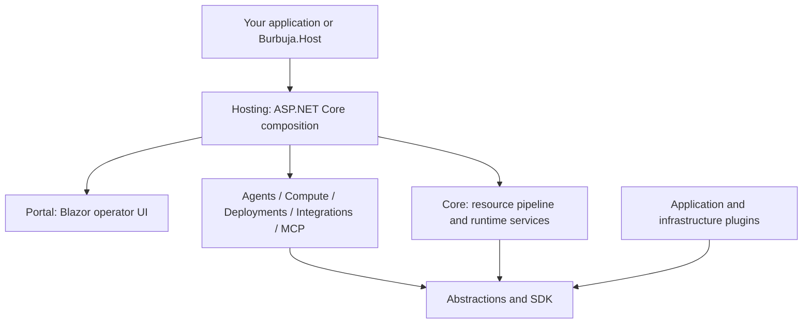

# Burbuja Kernel

Burbuja is a modular .NET runtime for applications that need a shared resource API,
background work or AI agents. It provides the infrastructure
around those features: authorization, policy and approvals, events, persistence,
plugin loading, and an operator portal.

Applications contribute their own resource types, tools, integrations, and
UI. You can run the included host or compose your own ASP.NET Core executable with
`Burbuja.Hosting`, as the examples do.

## What you can build

- **Resource services:** typed resources with JSON schemas, CRUD APIs, ETags,
  role-based access control, asynchronous operations, and event streams.
- **Agent applications:** one-shot jobs, fan-out orchestration, stateful agents
  with inboxes and sessions, model/tool loops, and cost budgets. DeepSeek and a deterministic scripted model provider are included.
- **Tool and integration services:** policy and approval gates for shell,
  workspace, and HTTP tools; a Model Context Protocol (MCP) server;
  mail, browser bridge, and Notion integration adapters.
- **Execution workflows:** local-directory and Git-worktree compute backends,
  plus deployment planning and local-process targets.


The resource API follows an ARM-style hierarchy:

```text
/subscriptions/{subscription}/resourceGroups/{group}/providers/{namespace}/{type}/{name}
```

For example, the Workbench plugin adds `Example.Workbench/notes`. Its host gets
resource routing, validation, authorization, concurrency checks, and event access
through the kernel. This API runs locally; it requires no Azure account.

## Try it locally

Install the .NET 10 SDK. The repository pins SDK `10.0.400` in
[global.json](global.json); `10.0.401` also satisfies that SDK selection.
Builds restore dependencies from NuGet.org. Python 3 and Make are used by the test
commands.

From a shell, clone the repository, publish the independent Workbench host, and
install its plugin:

```sh
git clone https://github.com/deep-dive-mexico/burbuja-kernel.git
cd burbuja-kernel

dotnet publish examples/Example.Workbench/Example.Workbench.Host -c Release \
  -o artifacts/workbench
dotnet publish examples/Example.Workbench/Example.Workbench.Plugin -c Release \
  -o artifacts/workbench/plugins/Example.Workbench
dotnet artifacts/workbench/Example.Workbench.Host.dll --urls=http://127.0.0.1:18490
```

Open <http://127.0.0.1:18490/workbench> and sign in with `owner` /
`owner-dev-password`. These are public development credentials for the local
example. Its resource and event stores are in memory; restarting clears them.

The [Workbench guide](docs/developer-workbench.md) walks through creating a
subscription, resource group, and note over HTTP, then checking roles, ETags,
and server-sent events. It also explains how to copy the example into a separate
repository and reference a pinned kernel checkout.

To start the generic host instead:

```sh
dotnet run --project src/Burbuja.Host -- --role all
curl -fsS http://127.0.0.1:18080/health/ready
```

This starts an empty host with no configured API keys or portal users. Configure
authentication and tenancy before using its protected APIs or portal. Persistence
is optional through the SQLite plugin; external integrations require their own
configuration and credentials.

## How it fits together



| Area | Responsibility |
| --- | --- |
| `Burbuja.Core.Abstractions` | Resource, authorization, policy, event, store, scheduling, and plugin contracts |
| `Burbuja.Core.Sdk` | Typed resource handlers, descriptors, clients, and reusable provider helpers |
| `Burbuja.Core` | Resource pipeline, routing, plugin loader, policy, scheduling, and default infrastructure |
| `Burbuja.Agents`, `Burbuja.Compute`, `Burbuja.Deployments` | Agent lifecycles, execution workspaces, and deployment resources, with separate contract projects |
| `Burbuja.Integrations`, `Burbuja.Mcp` | External-service adapters and MCP transport |
| `Burbuja.Hosting`, `Burbuja.Host`, `Burbuja.Portal` | Reusable host composition, the included executable, and operator UI |
| `plugins/` | Model, storage, policy, tool, and host-facts implementations |
| `Burbuja.TestKit`, `tests/`, `examples/` | Consumer test helpers, runtime verification, and standalone applications |

Hosting composes the supplied modules. Host roles are `control-plane`, `worker`,
and `all`. Applications can
register services and portals before plugin startup through
`BurbujaHostOptions.ConfigureBuilder`.

## Extend the kernel

Start with the [Workbench plugin](examples/Example.Workbench/Example.Workbench.Plugin).
It references the contracts and SDK, implements `IBurbujaPlugin`, and contributes
a resource provider, typed handler, roles, and event-stream resolver.

Dynamic plugins declare their identity and contributions in `plugin.json`. Install
the complete publish output in an immediate child of `Kernel:PluginsDirectory`.
The loader validates manifests and dependencies and shares contract types with
the host. See the [plugin guide](docs/plugin-review-2026-09-27.md) for installation
rules and failure diagnostics.

For a complete custom host, follow the source-reference composition in
[Example.Workbench](examples/Example.Workbench/README.md). Pin a released tag and
its full commit for consumers; Hosting is currently consumed from source.

## Examples

| Example | Demonstrates |
| --- | --- |
| [Workbench](examples/Example.Workbench/README.md) | Independent executable, custom portal, dynamic resource plugin, authentication, and HTTP APIs |

## Build and test

```sh
make build           # Release solution build
make test            # Build, then generic unit and consumer-host tests
```

[TestKit](src/Burbuja.TestKit/README.md) provides helpers for testing your
own host and plugins. Individual tests may require additional platform tools.

Local compute runs Bash processes with host permissions. Use an execution
environment appropriate to the code you run.

## Documentation

- [Custom host and Workbench](docs/developer-workbench.md)

## License

[MIT](LICENSE).
